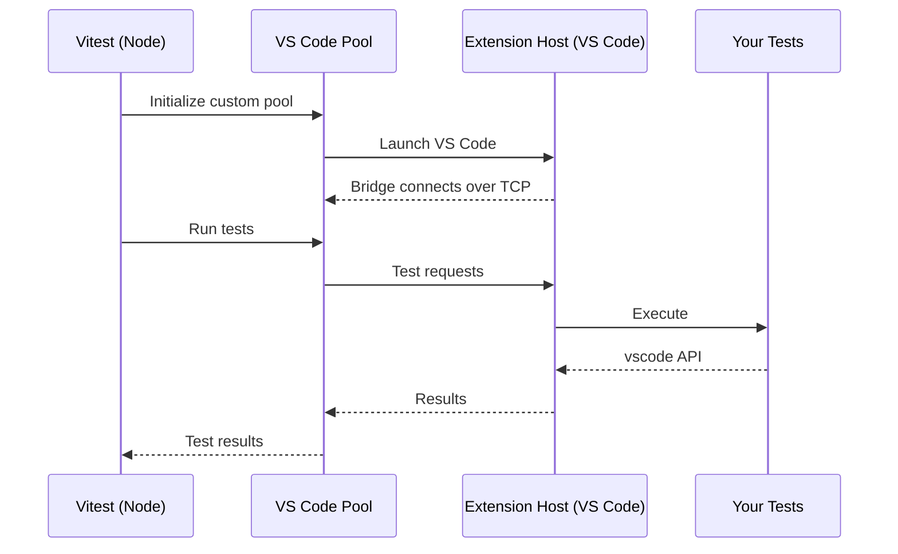

# vitest-plugin-vscode

[](https://github.com/Darhagonable/vitest-plugin-vscode/actions/workflows/ci.yml)
[](https://opensource.org/licenses/MIT)

**Test your VS Code extensions with the real deal.** A Vitest plugin that runs your test suites inside an actual VS Code Extension Host—no mocks, no compromises.

> This project is derived from [vitest-environment-vscode](https://www.npmjs.com/package/vitest-environment-vscode) ([repo](https://github.com/andrew-w-ross/vitest-enviroment-vscode)) by [andrew-w-ross](https://github.com/andrew-w-ross) and [@gitbybit/vscode-extension-test-vitest-runner](https://www.npmjs.com/package/@gitbybit/vscode-extension-test-vitest-runner) by [neochief](https://github.com/neochief).

## Why

Testing VS Code extensions shouldn't require elaborate mocking strategies or heavyweight fixtures. This plugin lets you:

- ✅ **Test against the real `vscode` API** — no synthetic stubs
- ✅ **Write standard Vitest tests** — same expect, describe, it you already know
- ✅ **Get fast feedback** — reuse the Extension Host across files for quick iteration
- ✅ **Debug naturally** — set breakpoints and inspect state like any Node.js app

## Getting started

Requires `vitest` 5 as a peer dependency. VS Code builds are downloaded per `platform` on macOS, Windows, and Linux.

### Install

```bash
npm install -D vitest vitest-plugin-vscode
# or
yarn add -D vitest vitest-plugin-vscode
# or
pnpm add -D vitest vitest-plugin-vscode
```

### Usage

```ts
// vitest.config.ts
import { defineConfig } from 'vitest/config';
import vscode from 'vitest-plugin-vscode';

export default defineConfig({
  plugins: [
    vscode({
      version: 'insiders', // or 'stable' / specific VS Code version tag
    }),
  ],
  test: {
    include: ['src/**/*.test.ts'],
  },
});
```

The `vscode` specifier resolves to the API provided inside the extension host — no stubs, no bundler configuration. Your extension source is loaded as the running extension, so tests can import and activate it directly:

```ts
// src/extension.test.ts
import { describe, it, expect } from 'vitest';
import * as vscode from 'vscode';
import { activate } from './extension';

describe('hello command', () => {
	it('executes inside VS Code', async () => {
		const result = await vscode.commands.executeCommand('my-extension.hello');
		expect(result).toBeUndefined();
	});
});
```

Debug like any vitest project: run with `--inspect-brk` and attach on the inspector port. Breakpoints hit in the extension host, not in the outer vitest process.

```bash
yarn vitest
# or
npm test
```

### Options

`vscode` vitest plugin accepts these options:

| Option                     | Default      | Description                                                                                                                                                                                                 |
| -------------------------- | ------------ | ----------------------------------------------------------------------------------------------------------------------------------------------------------------------------------------------------------- |
| `version`                  | `'stable'`   | VS Code build to download: `'stable'`, `'insiders'`, or a specific version tag like `'1.143.1'`. Overridden by `VSCODE_VERSION` environment variable if set.                                                |
| `reuseWorker`              | `true`       | Keep each test file's VS Code instance warm so watch-mode reruns reuse its extension host.                                                                                                                  |
| `vscodeExecutablePath`     | `undefined`  | Path to a VS Code executable to use for testing. If not specified, VS Code will be downloaded based on `version`.                                                                                           |
| `reuseMachineInstall`      | `false`      | Whether VS Code should be launched using default settings and extensions installed on this machine. If `false`, then separate directories will be used inside the `.vscode-test` folder within the project. |
| `extensionDevelopmentPath` | project root | The extension root loaded into the development host. Point Vitest's `root` at your extension directory, or pass an explicit path.                                                                           |
| `launchArgs`               | `[]`         | Additional arguments passed to the VS Code executable. See [`code --help`](https://code.visualstudio.com/docs/configure/command-line) for available options.                                                |
| `platform`                 | (auto)       | VS Code platform to download: `'darwin'`, `'darwin-arm64'`, `'win32-x64-archive'`, `'win32-arm64-archive'`, `'linux-x64'`, `'linux-arm64'`, `'linux-armhf'`                                                 |
| `cachePath`                | (auto)       | Directory where downloaded VS Code instances are cached. Defaults to `.vscode-test` in your project.                                                                                                        |
| `timeout`                  | `undefined`  | Milliseconds to wait for VS Code download before timing out.                                                                                                                                                |

- **Pin a specific VS Code version:** Set `version: '1.143.1'` for reproducible CI builds
- **Use your local VS Code:** Set `vscodeExecutablePath: '/Applications/Visual Studio Code.app/Contents/MacOS/Electron'` to test against your installed copy
- **Test with specific settings:** Use `reuseMachineInstall: true` to test with your actual VS Code configuration
- **Add workspace folders:** Include `launchArgs: ['path/to/workspace']` to open a specific workspace when testing

## Running in CI

Test multiple VS Code versions with a GitHub Actions matrix and the `VSCODE_VERSION` environment variable:

```yaml
jobs:
    test:
        strategy:
            matrix:
                vscode-version: [stable, insiders]
        steps:
            # ... setup steps ...
            - name: Run tests
              run: npm test
              env:
                  VSCODE_VERSION: ${{ matrix.vscode-version }}
```

On headless Linux runners, launch through `dbus-run-session` and `xvfb-run` — Electron needs a D-Bus session and a display:

```bash
dbus-run-session -- xvfb-run pnpm test
```

The first run downloads a ~300 MB VS Code build into `cachePath` (`.vscode-test` by default) — cache that directory between runs.

See the [CI workflow](.github/workflows/ci.yml) used by this repository for a complete setup.

## Development

### Commands

```bash
# Install dependencies
pnpm install

# Build
pnpm build

# Run all tests
pnpm test

# Run the sample extension directly
pnpm test:sample-extension

# Typecheck
pnpm typecheck
```

### Project structure

| Path                                | Description                                                                                                   |
| ----------------------------------- | ------------------------------------------------------------------------------------------------------------- |
| **`src/plugin.ts`**                 | The vitest plugin: `vscodePlugin()` entry point, options, the inline `vscode` shim, VS Code download pre-warm |
| **`src/pool.ts`**                   | The custom pool: spawns VS Code per worker, owns the TCP server, speaks vitest's worker protocol              |
| **`src/vscode-worker.ts`**          | The bridge: runs inside the extension host, connects back to the pool, executes the tests                     |
| **`src/utils/ipc.ts`**              | Newline-delimited IPC over TCP, used by both sides                                                            |
| **`src/index.ts`**                  | Public exports                                                                                                |
| **`tests/e2e/integration.test.ts`** | E2E suite: boots a nested vitest on the sample extension and asserts on its results                           |
| **`tests/unit/`**                   | Unit tests                                                                                                    |
| **`tests/_sample-extension/`**       | Sample VS Code extension used as the fixture                                                                  |

### Architecture



### Releasing

Create a GitHub Release with a tag like `v1.2.3` — that is the entire release ceremony. The tag is the single source of truth for the version: the publish workflow injects it into the package at publish time, so the `0.0.0` in `package.json` is a deliberate placeholder, not a mistake.

## Contributing

Contributions welcome! Please open an issue first to discuss what you'd like to change.

### Contributors

<a href="https://github.com/Darhagonable/vitest-plugin-vscode/graphs/contributors">
  
</a>

## License

MIT
